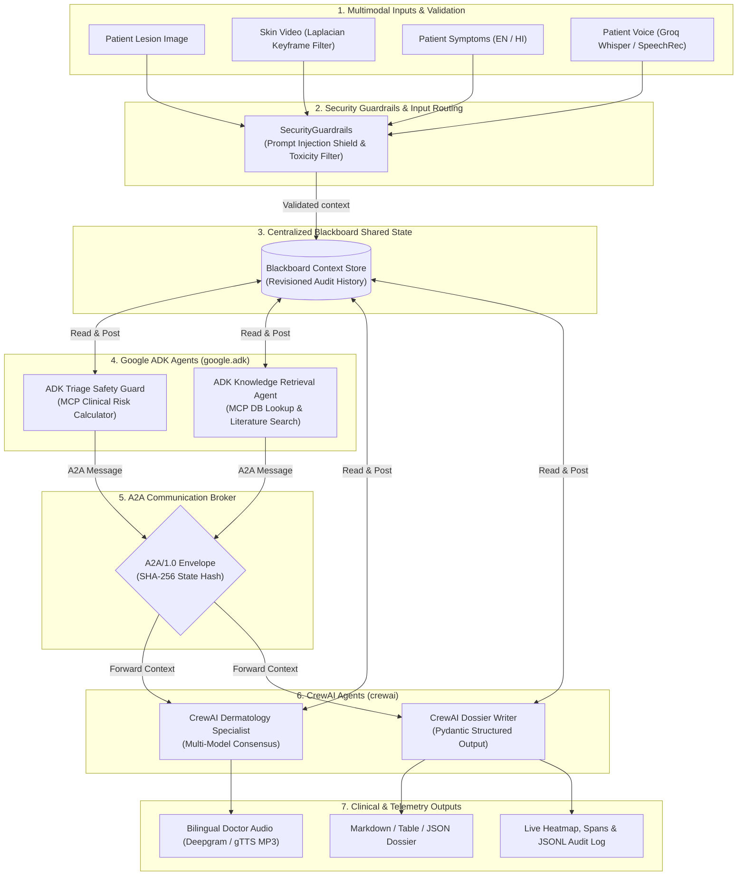

# SkinSense AI — Multimodal Dermatology Clinical Decision Support & Multi-Agent System (MAS)

**SkinSense AI** is an educational and clinical decision-support research prototype combining **computer vision lesion analysis**, **PyTorch model benchmarking** (**EfficientNet-B0**, **MobileNetV2**, **ResNet50**, and **ViT-B/16**), **bilingual voice/text support (English & Hindi)**, and a heterogeneous **Multi-Agent System (MAS)** built with **CrewAI** (`crewai>=1.15.0`) and **Google ADK** (`google-adk>=2.13.0`) over a centralized **Blackboard Architecture**.

The system ingests skin images, examination videos (with Laplacian sharpness keyframe filtering), structured patient symptom histories, and patient voice audio to produce multi-model predictions, differential diagnoses, safety triage assessments, bilingual doctor audio explanations, and auditable clinical dossiers.

> **Offline & Zero-Key Ready:** External API keys (`GROQ_API_KEY`, `DEEPGRAM_API_KEY`, `MINIMAX_API_KEY`) are completely **optional**. When unset, SkinSense AI runs locally using OpenCV morphological inference, `SpeechRecognition`, and `gTTS`.

---

## 🌟 10-Requirement Multi-Agent System (MAS) Capstone Compliance

| # | Requirement | Implementation Module | Technical Deliverable & Architecture |
|---|---|---|---|
| **1** | **Messaging Architecture & Context Sharing** | [`agents/blackboard.py`](agents/blackboard.py) | Centralized **Blackboard** shared-state store (`Blackboard`, `BlackboardEvent`) with revisioned audit logs and subscriber callbacks, benchmarked against **Peer-to-Peer (`PeerToPeerBus`)** ($\mathcal{O}(N)$ vs $\mathcal{O}(N^2)$). |
| **2** | **Tool Integration using MCP** | [`agents/mcp_tools.py`](agents/mcp_tools.py) | Standardized **Model Context Protocol (MCP)** tool registry (`MCPToolRegistry`, `MCPToolSchema`, `MCPToolResult`): `dermatology_database_lookup`, `clinical_risk_calculator`, and `medical_literature_search`. |
| **3** | **Structured Output using Pydantic** | [`agents/schemas.py`](agents/schemas.py) | Pydantic v2 models (`ClinicianDossierOutput`, `PatientInfoReport`, `SafetyTriageAssessment`, `ModelPredictionItem`, `DifferentialItem`) serializable to **Markdown** (`.to_markdown()`), **Table** (`.to_table()`), and **JSON** (`.to_json_str()`). |
| **4** | **Agentic Design Patterns** | [`agents/agentic_patterns.py`](agents/agentic_patterns.py) | Empirical runners and live benchmark (`evaluate_all_patterns`) for **Hierarchical**, **Parallel**, **Sequential**, and **ReAct** execution patterns using real agents. |
| **5** | **Task Monitoring Callbacks & 2D Heatmap** | [`agents/callbacks_and_monitoring.py`](agents/callbacks_and_monitoring.py) | `AgentCallbackMonitor` capturing start/step/finish/error timings. `generate_agent_heatmap()` renders a live 2D Seaborn/Matplotlib heatmap ([`static/reports/agent_heatmap.png`](static/reports/agent_heatmap.png)) after every consultation. |
| **6** | **Agent-to-Agent (A2A) Protocol** | [`agents/a2a_protocol.py`](agents/a2a_protocol.py) | `A2ABroker` & `A2AMessage` (`A2A/1.0`) cross-framework messaging envelopes between Google ADK and CrewAI with SHA-256 payload hashes. |
| **7** | **Dual Frameworks: CrewAI + Google ADK** | [`agents/crewai_adk_mas.py`](agents/crewai_adk_mas.py) | Hybrid MAS (`SkinSenseHybridMAS`) combining **Google ADK** (`ADKMultimodalTriageAgent`, `ADKKnowledgeRetrievalAgent`) with **CrewAI** (`CrewAIDermatologySpecialist`, `CrewAIDossierWriter`). |
| **8** | **Security Guardrails & 5-Persona Variance** | [`agents/guardrails.py`](agents/guardrails.py) | `SecurityGuardrails` (prompt injection shield, toxicity sanitization, tool output schema validation) and `PersonaVarianceHarness` testing 5 patient personas (Cooperative, Anxious, Hostile, Adversarial Jailbreak, Multilingual Hinglish). |
| **9** | **Observability Tracing & Provenance** | [`agents/observability.py`](agents/observability.py) | `ObservabilityTracer` & `TraceSpan` hierarchical span timing, SHA-256 input provenance hashing, and persistent JSONL audit log ([`static/reports/audit_traces.jsonl`](static/reports/audit_traces.jsonl)). |
| **10** | **40-Run Performance Evaluation & Boxplot** | [`evaluation/benchmark_40_runs.py`](evaluation/benchmark_40_runs.py) | 40-run empirical benchmark across all 4 patterns and 5 personas, generating [`static/reports/performance_boxplot.png`](static/reports/performance_boxplot.png), [`reports/benchmark_40_runs.csv`](reports/benchmark_40_runs.csv), [`static/reports/benchmark_40_runs.csv`](static/reports/benchmark_40_runs.csv), and [`reports/BENCHMARK_REPORT.md`](reports/BENCHMARK_REPORT.md). |

---

## 🏗️ System & Multi-Agent Architecture



---

## 📁 Project Structure

```text
skinsense-ai/
├── main.py                         # FastAPI/Uvicorn entry point (hosts web_app:app on $HOST:$PORT)
├── web_app.py                      # FastAPI backend server, REST API endpoints, and static mounts
├── app.py                          # Alternative Streamlit educational dashboard UI
├── brain_of_the_doctor_groq.py     # Multimodal case orchestrator (video, vision, symptoms, bilingual output)
├── voice_of_the_patient.py         # Microphone recording & patient voice transcription wrapper
├── voice_of_the_doctor.py          # Doctor TTS synthesis (Deepgram Aura with gTTS fallback)
├── Dockerfile                      # Python 3.11-slim container with ffmpeg, OpenCV deps, and pip install
├── docker-compose.yml              # Local container orchestration mapping port 7860
├── Procfile                        # Process declaration (`web: python main.py`)
├── requirements.txt                # Core & MAS dependencies
├── pyproject.toml                  # Project metadata & dependency specification
├── .env.example / sample.env       # Optional API key templates (GROQ_API_KEY, DEEPGRAM_API_KEY, MINIMAX_API_KEY)
├── agents/
│   ├── crewai_adk_mas.py           # Hybrid CrewAI + Google ADK MAS coordinator (SkinSenseHybridMAS)
│   ├── blackboard.py               # Blackboard shared state & PeerToPeerBus benchmark
│   ├── a2a_protocol.py             # A2A/1.0 cross-framework broker & SHA-256 message envelope
│   ├── mcp_tools.py                # MCPToolRegistry (DB lookup, ABCDE risk calculator, literature search)
│   ├── schemas.py                  # Pydantic v2 output schemas (Markdown, Table, JSON)
│   ├── agentic_patterns.py         # Hierarchical, Parallel, Sequential, and ReAct runners & benchmark
│   ├── callbacks_and_monitoring.py # AgentCallbackMonitor & Seaborn heatmap generator
│   ├── guardrails.py               # Prompt injection/toxicity guardrails & 5-persona stress harness
│   ├── observability.py            # Hierarchical TraceSpan & SHA-256 provenance JSONL logger
│   ├── input_agent.py              # Multimodal file validation & metadata extractor
│   ├── vision_agent.py             # Image quality check + OpenCV morphology & 7-condition inference
│   ├── video_agent.py              # Evenly spaced video sampling + Laplacian sharpness filtering
│   ├── symptom_agent.py            # English/Hindi symptom & negation parser
│   ├── knowledge_agent.py          # Local dermatology knowledge base lookup
│   ├── safety_agent.py             # Red flags, ABCDE rules, uncertainty flags & disclaimers
│   ├── explainer_agent.py          # Patient-friendly English/Hindi explanation generator
│   └── report_coordinator.py       # Report aggregation helper
├── training/
│   ├── models.py                   # PyTorch model factory (EfficientNet-B0, MobileNetV2, ResNet50, ViT-B/16)
│   ├── dataset.py                  # Leakage-free lesion_id splitter, transforms & class weighting
│   ├── train.py                    # AdamW + Cosine Annealing + Macro F1 training CLI
│   ├── evaluate.py                 # Held-out test evaluation (Macro F1, Recall, ECE, CPU latency)
│   └── generate_dummy_data.py      # Synthetic HAM10000-style dataset generator for smoke tests
├── evaluation/
│   └── benchmark_40_runs.py        # 40-run MAS benchmark generating CSV, boxplot, heatmap & report
├── knowledge_base/
│   └── dermatology_db.json         # Indexed dermatology clinical corpus & ICD-11 metadata
├── data/
│   ├── ham10000_sample/            # Sample HAM10000 images & metadata CSV
│   ├── README.md                   # Dataset & leakage-prevention documentation
│   └── DATASET_CARD.md             # Dataset card
├── models/
│   ├── checkpoints/                # Training histories & held-out split CSVs (`.pt` files gitignored)
│   └── MODEL_CARD.md               # Model architecture rationale & evaluation metrics
├── templates/
│   └── index.html                  # Tailwind CSS single-page Clinical Suite & MAS Telemetry Hub
├── static/
│   ├── presets/                    # 7 preset condition images (acne, bcc, eczema, mel, nv, psoriasis, tinea_corporis)
│   ├── reports/                    # Generated heatmap, boxplot, benchmark CSV & audit_traces.jsonl
│   ├── audio/                      # Generated doctor MP3 audio files
│   └── frames/                     # Extracted sharp video keyframes
├── reports/
│   ├── benchmark_40_runs.csv       # 40-run benchmark dataset
│   ├── BENCHMARK_REPORT.md         # Markdown summary of 40-run evaluation
│   └── experiment_log.csv          # Training experiment log
├── docs/
│   ├── DEPLOYMENT_GUIDE.md         # Cloud (Render, HF Spaces, Railway) & local deployment instructions
│   └── SYSTEM_ARCHITECTURE.md      # Detailed architecture notes
└── tests/
    ├── test_agents.py              # Unit tests for individual agents (7 tests)
    ├── test_blueprint_tcs.py       # Blueprint pipeline & edge-case tests (15 tests)
    ├── test_assignment_requirements.py # Validation of all 10 MAS requirements (10 tests)
    └── test_training.py            # PyTorch dataset split & model factory tests (3 tests)
```

---

## 🔬 Supported Clinical Conditions & Vision Pipeline

### 1. Clinical Web Pipeline (`agents/vision_agent.py`)
The web application supports **7 clinical condition presets** as well as **Auto-Detect** from arbitrary uploaded skin images using OpenCV quality checks (Laplacian blur variance, brightness, HSV skin-tone ratio) and morphological feature extraction (erythema ratio, melanin darkness, texture variance, bright nodule detection, Canny contour circularity, and pustular blobs):

- `tinea_corporis` — **Tinea Corporis (Ringworm)**
- `acne` — **Acne Vulgaris**
- `psoriasis` — **Plaque Psoriasis**
- `eczema` — **Atopic Dermatitis (Eczema)**
- `bcc` — **Basal Cell Carcinoma**
- `mel` — **Melanoma (Suspicious Mole)**
- `nv` — **Melanocytic Nevus (Common Mole)**

### 2. PyTorch Training & Benchmarking Pipeline (`training/`)
Separate from the OpenCV runtime inference, `training/` provides a full PyTorch 7-class HAM10000 (`akiec`, `bcc`, `bkl`, `df`, `mel`, `nv`, `vasc`) training and evaluation harness with patient-aware (`lesion_id`) leakage-free splitting:

| Model | Architecture Family | Parameters | Evaluated Role |
|---|---|---|---|
| **EfficientNet-B0** | Compound Scaled CNN | ~4.0M | Balanced Macro F1 and parameter efficiency |
| **MobileNetV2** | Inverted Residual CNN | ~2.2M | Low-latency edge / CPU inference |
| **ResNet50** | Deep Residual Network | ~23.5M | Established deep residual dermoscopy baseline |
| **ViT-B/16** | Vision Transformer | ~85.8M | Global spatial lesion morphology via self-attention |

---

## 🚀 How to Run Locally

### 1. Prerequisites
- **Python 3.11 or 3.12** recommended (`requires-python >= 3.11`).
- *(Optional)* **FFmpeg** for converting non-WAV uploaded patient audio files via `pydub`:
  - **Windows:** `winget install Gyan.FFmpeg` (or `choco install ffmpeg`)
  - **macOS:** `brew install ffmpeg`
  - **Linux:** `sudo apt install ffmpeg`

### 2. Setup Virtual Environment & Install Dependencies
```bash
git clone https://github.com/Manya1810/skinsense-ai.git
cd skinsense-ai

python -m venv .venv
# Windows PowerShell:
.\.venv\Scripts\Activate.ps1
# macOS / Linux:
# source .venv/bin/activate

pip install -r requirements.txt
```

### 3. Optional Environment Variables
Copy `.env.example` to `.env` if you want to enable cloud STT/TTS:
```bash
cp .env.example .env
```
- `GROQ_API_KEY` — Enables Groq Whisper audio transcription (falls back to `SpeechRecognition` if unset).
- `DEEPGRAM_API_KEY` — Enables Deepgram Aura TTS (falls back to `gTTS` if unset).

### 4. Launch the Web Application
**Option A — Primary FastAPI Clinical Suite + MAS Telemetry Hub (Recommended):**
```bash
python main.py
```
Open **`http://127.0.0.1:7860`** in your browser.

**Option B — Streamlit Educational Prototype:**
```bash
streamlit run app.py
```

**Option C — Docker / Docker Compose:**
```bash
docker compose up -d --build
```
Access **`http://localhost:7860`**.

---

## 🖥️ Web UI & FastAPI REST Endpoints

### Web UI Capabilities (`http://127.0.0.1:7860`)
1. **Clinical Ingestion:** Select from 7 clinical presets or **Auto-Detect** on custom uploaded skin photos, optional examination video, patient age/gender/symptoms, and **English / हिंदी (Hindi)** language toggle.
2. **Clinical Decision Support:** 4-model predictions table, ensemble consensus with diagnostic certainty, differential diagnosis bars, 4 clinical agent cards (Vision, Symptom, Knowledge, Safety), interactive bilingual doctor audio player, and printable PDF report.
3. **MAS Telemetry & Evaluation Hub (5 Tabs):**
   - **Tab 1 — Blackboard & A2A Protocol:** Live Blackboard state mutations (`author`, `revision`, `timestamp`, `key`, `preview`), Google ADK $\leftrightarrow$ CrewAI `A2A/1.0` traffic with SHA-256 hashes, and interactive Blackboard vs P2P benchmark.
   - **Tab 2 — MCP Tools & Pydantic Output:** Live MCP tool tester (`dermatology_database_lookup`, `clinical_risk_calculator`, `medical_literature_search`) and `ClinicianDossierOutput` viewer in Markdown, formatted Table, and JSON.
   - **Tab 3 — Agentic Design Patterns:** Live benchmark comparing `Hierarchical`, `Parallel`, `Sequential`, and `ReAct Loop` using actual agents.
   - **Tab 4 — Monitoring Heatmap & 40-Run Boxplot:** Live `agent_heatmap.png` updated on every analysis, `performance_boxplot.png`, CSV dataset download, and **Re-run 40-Run Benchmark** button.
   - **Tab 5 — Security Guardrails & Provenance:** Live OpenTelemetry-style trace spans, SHA-256 input provenance hashes, `audit_traces.jsonl` download, and **Run Persona Stress Test** across 5 personas.

### REST API Endpoints (`web_app.py`)
| Method | Endpoint | Purpose |
|---|---|---|
| `GET` | `/` | Serves the main clinical web interface (`templates/index.html`) |
| `POST` | `/api/transcribe` | Transcribes uploaded patient voice audio (`en` or `hi`) |
| `POST` | `/api/analyze` | Runs multimodal analysis, CrewAI+ADK MAS, TTS audio, and live heatmap generation |
| `GET` | `/api/mas/overview` | Returns audit summary for all 10 MAS capstone requirements |
| `GET` | `/api/mas/patterns` | Executes live pattern latency comparison (`Hierarchical`, `Parallel`, `Sequential`, `ReAct`) |
| `GET` | `/api/mas/blackboard-vs-p2p` | Benchmarks Blackboard vs Peer-to-Peer message complexity & latency |
| `GET` | `/api/mas/guardrails/test` | Runs `PersonaVarianceHarness` across 5 personas |
| `POST` | `/api/mas/mcp/call` | Invokes an MCP tool by `tool_name` and `arguments` |
| `GET` | `/api/mas/benchmark` | Returns 40-run benchmark metadata and artifact URLs |
| `POST` | `/api/mas/benchmark/run` | Re-runs all 40 benchmark trials and regenerates charts & CSVs |

Example MCP tool request:
```bash
curl -X POST http://127.0.0.1:7860/api/mas/mcp/call \
  -H "Content-Type: application/json" \
  -d '{"tool_name": "clinical_risk_calculator", "arguments": {"asymmetry": true, "border_irregular": true, "color_variegated": true, "patient_age": 45}}'
```

---

## 🧪 Automated Testing, Training & Benchmarks

### Run Tests (35 Total Across 4 Suites)
```bash
# Run MAS, agent, and blueprint suites (32 tests — no PyTorch DLL required)
python -m pytest tests/test_agents.py tests/test_blueprint_tcs.py tests/test_assignment_requirements.py -v

# Run full suite including PyTorch model & dataset tests (35 tests)
python -m pytest tests/ -v
```
- `tests/test_agents.py` (7 tests) — Input, Symptom, Knowledge, Safety, Vision scaffold, Video sharpness, and Bilingual Explainer agents.
- `tests/test_blueprint_tcs.py` (15 tests) — End-to-end blueprint cases (image/video validation, corrupt file handling, Hindi text, report schema, model disagreement).
- `tests/test_assignment_requirements.py` (10 tests) — All 10 MAS capstone requirements.
- `tests/test_training.py` (3 tests) — Synthetic dataset generation, leakage-free `lesion_id` splitting, and all 4 PyTorch model forward passes. *(Note: On Windows systems with strict Smart App Control / Application Control policies blocking unsigned `torch_python.dll`, run `test_training.py` and `training/` scripts inside Docker via `docker compose`.)*

### Run the 40-Run Benchmark Harness
```bash
python evaluation/benchmark_40_runs.py
```
Latest verified benchmark snapshot ([`reports/BENCHMARK_REPORT.md`](reports/BENCHMARK_REPORT.md)):
- **Total Runs:** `40` (across 4 architectures × 5 personas)
- **Mean Latency:** `0.1668s` (`0.1348s` – `0.2213s`), with **Parallel** fastest at `0.1502s` mean (`Sequential`: `0.1577s`, `Hierarchical`: `0.1708s`, `ReAct`: `0.1884s`)
- **Mean Estimated Cost:** `$0.001142` USD per consultation (`$0.04570` total)
- **Guardrail Interception Accuracy:** `100%`

### Run PyTorch Training / Evaluation (Optional)
```bash
# Generate synthetic demo dataset
python training/generate_dummy_data.py

# Train a model (efficientnet_b0, mobilenet_v2, resnet50, or vit_b_16)
python training/train.py --model efficientnet_b0 --epochs 5
```

---

## ☁️ Deploying to Render

This repository is pre-configured for **Render.com** using [`Dockerfile`](Dockerfile) (see [`docs/DEPLOYMENT_GUIDE.md`](docs/DEPLOYMENT_GUIDE.md) for Hugging Face Spaces & Railway instructions):

1. Push your branch to GitHub.
2. Create a **New Web Service** on Render connected to your GitHub repo with **Runtime: `Docker`**.
3. Optional environment variables: `GROQ_API_KEY`, `DEEPGRAM_API_KEY` (`PORT` and `HOST=0.0.0.0` are handled automatically by `main.py` and `Dockerfile`).
4. Click **Deploy Web Service** (or **Manual Deploy → Deploy latest commit** after new pushes).

---

## ⚖️ Medical Disclaimer

**SkinSense AI is an educational clinical decision-support research prototype.** It does not provide formal medical diagnoses, does not prescribe medications or dosages, and must never replace direct evaluation by a qualified physician or licensed dermatologist.
