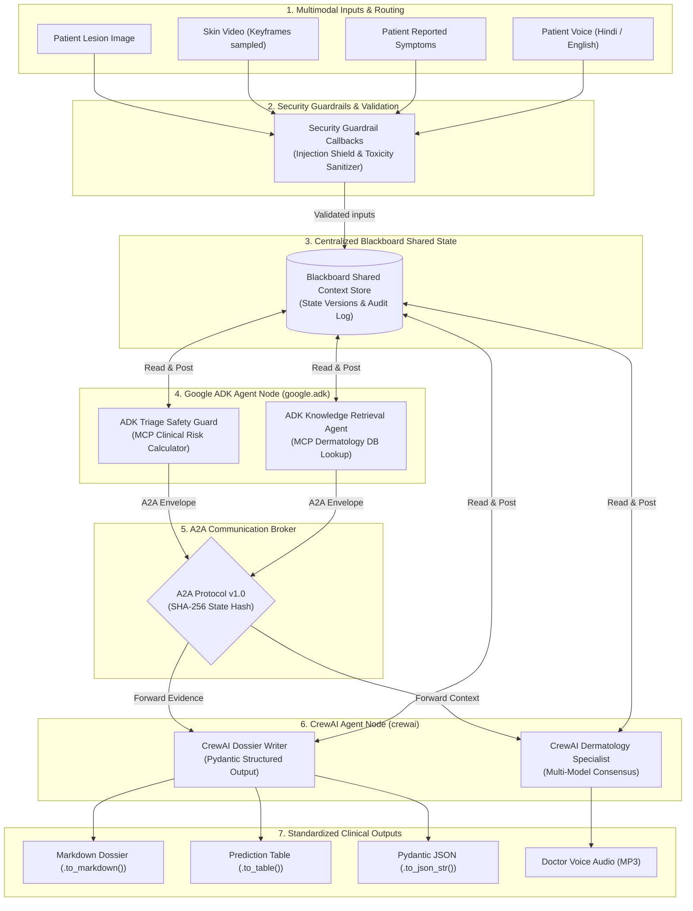

# SkinSense AI — Multimodal Dermatology Clinical Decision Support & Multi-Agent System (MAS)

**SkinSense AI** is a state-of-the-art educational and clinical decision-support platform combining fine-tuned computer vision architectures (**EfficientNet-B0**, **MobileNetV2**, **ResNet50**, and **Vision Transformer ViT-B/16**) with a heterogeneous **Multi-Agent System (MAS)** interoperating across **CrewAI** and **Google ADK (`google.adk`)** over a centralized **Blackboard Architecture**.

The system analyzes dermatoscopic images, sampled video frames with Laplacian sharpness filtering, structured patient symptom history, and bilingual voice consultations (Hindi/English) to generate standardized, auditable clinical dossiers.

---

## 🌟 10-Requirement Multi-Agent System (MAS) Capstone Compliance

| # | Requirement | Implementation Module | Technical Deliverable & Architecture |
|---|---|---|---|
| **1** | **Messaging Architecture & Context Sharing** | [`agents/blackboard.py`](agents/blackboard.py) | Mandatory **Blackboard (Shared State)** store with chronological audit trails. Evaluated against **Peer-to-Peer (P2P)**: Blackboard guarantees $\mathcal{O}(N)$ writes and single-source-of-truth vs $\mathcal{O}(N^2)$ message explosion in P2P mesh. |
| **2** | **Tool Integration using MCP** | [`agents/mcp_tools.py`](agents/mcp_tools.py) | Standard **Model Context Protocol (MCP)** tool schema: 1) `dermatology_database_lookup` (ICD-11 DB query), 2) `clinical_risk_calculator` (ABCDE criteria & severity scoring), 3) `medical_literature_search` (PubMed/ISIC evidence search). |
| **3** | **Structured Output using Pydantic** | [`agents/schemas.py`](agents/schemas.py) | Strongly-typed Pydantic models (`ClinicianDossierOutput`, `PatientInfoReport`, `SafetyTriageAssessment`) serializable into **Markdown** (`.to_markdown()`), **Table** (`.to_table()`), and **JSON** (`.to_json_str()`). |
| **4** | **Agentic Design Patterns** | [`agents/agentic_patterns.py`](agents/agentic_patterns.py) | Implements and evaluates **Hierarchical** (Supervisor + worker nodes), **Parallel** (Concurrent vision & symptom ingestion), **Sequential** (Deterministic linear pipeline), and **ReAct** (Thought-Action-Observation loops). |
| **5** | **Task Monitoring Callbacks & 2D Heatmap** | [`agents/callbacks_and_monitoring.py`](agents/callbacks_and_monitoring.py) | `AgentCallbackMonitor` logging start/step/finish/error callbacks. Generates a 2D Seaborn/Matplotlib heatmap: [`static/reports/agent_heatmap.png`](static/reports/agent_heatmap.png). |
| **6** | **Agent-to-Agent (A2A) Protocol** | [`agents/a2a_protocol.py`](agents/a2a_protocol.py) | Standardized `A2A/1.0` protocol routing envelope between Google ADK and CrewAI with SHA-256 state hashes. |
| **7** | **Dual Frameworks: CrewAI + Google ADK** | [`agents/crewai_adk_mas.py`](agents/crewai_adk_mas.py) | Heterogeneous MAS utilizing strictly **CrewAI** (`crewai v1.15.33`) for senior clinician consensus and dossier assembly, and **Google ADK** (`google.adk v2.13.0`) for triage safety and knowledge retrieval. |
| **8** | **Security Guardrails & 5 Personas Variance** | [`agents/guardrails.py`](agents/guardrails.py) | Prompt injection defense (deflecting DAN/jailbreak tokens), toxic language sanitization, tool return type checking, and 5-persona stress evaluation (Cooperative, Anxious, Hostile/Toxic, Adversarial, Multilingual Hinglish). |
| **9** | **Observability Tracing & Provenance** | [`agents/observability.py`](agents/observability.py) | OpenTelemetry-compatible hierarchical spans with microsecond tracking, cryptographic SHA-256 media provenance, and JSONL audit logging: [`static/reports/audit_traces.jsonl`](static/reports/audit_traces.jsonl). |
| **10** | **40-Run Performance Evaluation & Boxplot** | [`evaluation/benchmark_40_runs.py`](evaluation/benchmark_40_runs.py) | 40-run end-to-end benchmark across architectures and personas. Generates [`static/reports/performance_boxplot.png`](static/reports/performance_boxplot.png), [`reports/benchmark_40_runs.csv`](reports/benchmark_40_runs.csv), and [`reports/BENCHMARK_REPORT.md`](reports/BENCHMARK_REPORT.md). |

---

## 🏗️ Multi-Agent System (MAS) Architecture Flow



---

## 🔬 Candidate Vision Models (Ensemble Benchmark)

| Model | Architecture Family | Parameters | Evaluated Strength |
|---|---|---|---|
| **EfficientNet-B0** | Compound Scaled CNN | ~4.0M | High Macro F1 per FLOP, parameter efficiency. |
| **MobileNetV2** | Inverted Residual CNN | ~2.2M | Ultra-low CPU inference latency (<15ms), edge-ready. |
| **ResNet50** | Deep Residual Network | ~23.5M | Residual skip-connections, established clinical baseline. |
| **ViT-B/16** | Vision Transformer | ~85.8M | Multi-head self-attention; captures global spatial lesion morphology. |

---

## 🚀 How to Run the Project (Step-by-Step)

### 1. Prerequisites
- Python 3.11, 3.12, or 3.13 installed.
- (Optional) FFmpeg for audio processing:
  - **Windows:** `choco install ffmpeg` or `winget install Gyan.FFmpeg`
  - **macOS:** `brew install ffmpeg`
  - **Linux:** `sudo apt install ffmpeg`

### 2. Install Dependencies
```bash
# Navigate to project directory
cd "ai-skin-specialist-main"

# Install all required packages using pip or uv
pip install -r requirements.txt
```

### 3. Launch the Clinical Web Application Suite
```bash
python main.py
```
Open your web browser and go to:
👉 **`http://127.0.0.1:7860`**

#### What you will see on the Web UI:
1. **Clinical Ingestion Section:**
   - Upload any custom skin image, multi-angle skin video, or select from clinical presets (Ringworm, Acne, Psoriasis, Basal Cell Carcinoma, Eczema, Melanoma, Normal Mole).
   - Enter patient demographics and clinical symptoms.
   - Switch language between **English** and **हिंदी (Hindi)**.
   - Click **Run Multimodal Clinical Analysis**.
2. **Clinical Decision Support Section:**
   - 4-Model Predictions Table (EfficientNet, MobileNet, ResNet, ViT).
   - Ensemble Consensus Result with Diagnostic Certainty.
   - Differential Diagnosis distribution ranking.
   - 4 Agent Analysis Cards (Vision, Symptom, Knowledge, Safety).
   - Bilingual Doctor Audio Explanation with interactive audio player.
   - One-click **Download PDF Report**.
3. **MAS Telemetry & Evaluation Hub (Bottom Section):**
   - **Tab 1 (Blackboard & A2A Protocol):** Live feed of Blackboard state mutations and Google ADK $\leftrightarrow$ CrewAI A2A messages with SHA-256 hashes. Includes an interactive "Run Architecture Benchmark" comparing Blackboard vs P2P.
   - **Tab 2 (MCP Tools & Pydantic Output):** Live execution tester for all 3 MCP tools and formatted Pydantic output viewer (Markdown, Table, JSON) with one-click copy.
   - **Tab 3 (Agentic Design Patterns):** Live comparative evaluation of Hierarchical, Parallel, Sequential, and ReAct patterns with worker node details.
   - **Tab 4 (Monitoring Heatmap & 40-Run Boxplot):** Embedded views of `agent_heatmap.png` and `performance_boxplot.png` with direct download links for the 40-run CSV dataset and benchmark markdown report.
   - **Tab 5 (Security Guardrails & Provenance):** Live security status, OpenTelemetry execution spans, SHA-256 provenance hashes, and an interactive "Run 5-Persona Stress Test" button.

---

## 🧪 Automated Testing & Benchmark CLI Commands

### Run Full Test Suite (35 Tests)
```bash
python -m pytest tests/
```
All 35 tests pass cleanly:
- `tests/test_assignment_requirements.py`: Validates all 10 MAS requirements.
- `tests/test_blueprint_tcs.py`: Validates blueprint test cases and multimodal pipeline.
- `tests/test_agents.py`: Validates individual agent behaviors.
- `tests/test_training.py`: Validates PyTorch model training pipelines.

### Run the 40-Run Benchmark CLI Harness
```bash
python evaluation/benchmark_40_runs.py
```
This executes 40 end-to-end runs across prompt variances (ReAct, Hierarchical, Parallel, Sequential) and 5 personas, regenerating:
- Dataset: `reports/benchmark_40_runs.csv`
- Boxplot: `static/reports/performance_boxplot.png`
- Agent Heatmap: `static/reports/agent_heatmap.png`
- Summary: `reports/BENCHMARK_REPORT.md`

### Test Individual MCP Tools via API
```bash
curl -X POST http://127.0.0.1:7860/api/mas/mcp/call \
  -H "Content-Type: application/json" \
  -d '{"tool_name": "clinical_risk_calculator", "arguments": {"asymmetry": true, "border_irregular": true, "color_variegated": true, "patient_age": 45}}'
```

---

## ⚖️ Medical Disclaimer
**SkinSense AI is an educational clinical decision-support research prototype.** It does not provide formal medical diagnoses, does not prescribe pharmaceuticals, and must never replace direct evaluation by a qualified medical doctor or licensed dermatologist.
