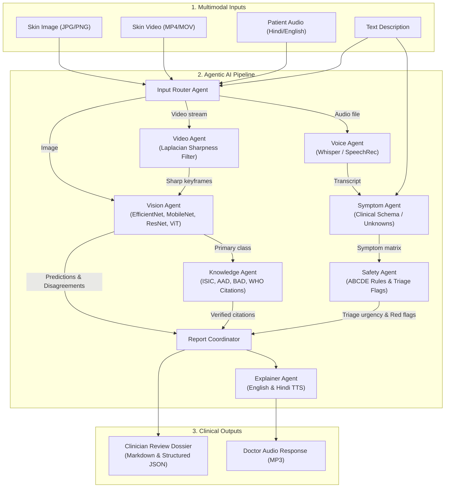
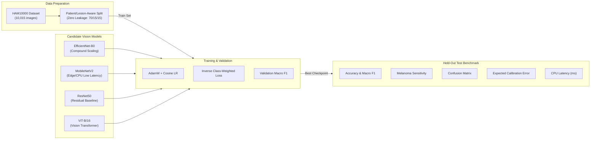

# SkinSense AI — System Architecture & Multi-Agent Orchestration

## High-Level System Architecture

SkinSense AI separates statistical computer vision from symptom extraction, medical knowledge retrieval, safety guardrails, and language communication.

---

## 4-Model Training & Evaluation Pipeline

---

## Agent Responsibilities Matrix

| Agent Name | Primary Responsibility | Truthful Safety & Grounding Boundary |
|---|---|---|
| **Input Router Agent** | File validation, format check, resolution inspection. | Rejects corrupted media, verifies minimum dimensions. |
| **Video Agent** | Samples key frames, Laplacian sharpness filtering (`cv2.Laplacian.var()`), computes multi-angle consensus. | Discards blurry frames; flags multi-angle visual inconsistencies. |
| **Voice Agent** | Transcribes speech in Hindi and English. | Surfaces editable transcript for patient review before proceeding. |
| **Symptom Agent** | Extracts clinical duration, bleeding, pain, growth, location. | **Never hallucinates.** Missing attributes are strictly labeled `"unknown"`. |
| **Vision Agent** | Executes PyTorch inference across the 4 candidate models. | Emits honest `"scaffold ready"` if no checkpoint is trained; flags model disagreements. |
| **Knowledge Agent** | Queries curated dermatology knowledge base (`dermatology_db.json`). | Returns verified peer-reviewed citations (ISIC, AAD, BAD, WHO) with links. |
| **Safety Agent** | Evaluates ABCDE melanoma criteria, red flag symptoms, confidence thresholds. | Hardcoded non-overridable rules. Refuses drug prescriptions. Stamped disclaimers. |
| **Report Coordinator** | Compiles all outputs into unified Clinician Dossier. | Preserves disagreements, notes missing modalities. |
| **Explainer Agent** | Translates clinician findings into bilingual patient explanation. | Uses only validated facts. Formats clean text for text-to-speech. |

---

## Multi-Agent System (MAS) Capstone Specifications

### 1. Dual Framework Architecture (CrewAI + Google ADK)
The MAS subsystem interoperates across two leading agentic frameworks:
- **Google ADK (`google.adk` v2.13.0):** Powers `ADKMultimodalTriageAgent` (safety guardrails, input validation) and `ADKKnowledgeRetrievalAgent` (MCP knowledge base and literature search).
- **CrewAI (`crewai` v1.15.33):** Powers `CrewAIDermatologySpecialist` (clinical consensus formulation) and `CrewAIDossierWriter` (Pydantic clinician dossier assembly).

### 2. Context Sharing: Blackboard Architecture vs. Peer-to-Peer
- **Blackboard (`Blackboard`):** Mandatory centralized shared state storing all agent intermediate representations with chronological event logs.
- **Complexity:** $\mathcal{O}(N)$ writes and $\mathcal{O}(1)$ snapshot reads compared to $\mathcal{O}(N^2)$ message fan-out in Peer-to-Peer mesh networks.

### 3. Model Context Protocol (MCP) External Tools
1. `dermatology_database_lookup`: Queries clinical conditions, ICD-11 codes, and treatment lines.
2. `clinical_risk_calculator`: Evaluates ABCDE melanoma criteria and computes clinical urgency index.
3. `medical_literature_search`: Retrieves PubMed and ISIC citations for peer-reviewed guidelines.

### 4. Agent-to-Agent (A2A) Protocol
Heterogeneous messages between Google ADK and CrewAI are routed via the `A2A/1.0` envelope with SHA-256 state hashes.

### 5. Security Guardrails & Persona Variance
- Prompt injection filter (blocking DAN/jailbreak instructions).
- Abusive/toxic language sanitizer.
- Tool return type validation callbacks.
- 5-Persona variance suite: Cooperative, Anxious, Hostile/Toxic, Adversarial Jailbreak, Multilingual Hinglish.

### 6. Observability & Provenance
- OpenTelemetry-compatible hierarchical spans with microsecond tracking.
- SHA-256 cryptographic provenance for media inputs.
- Persistent JSONL audit logging (`audit_traces.jsonl`).

