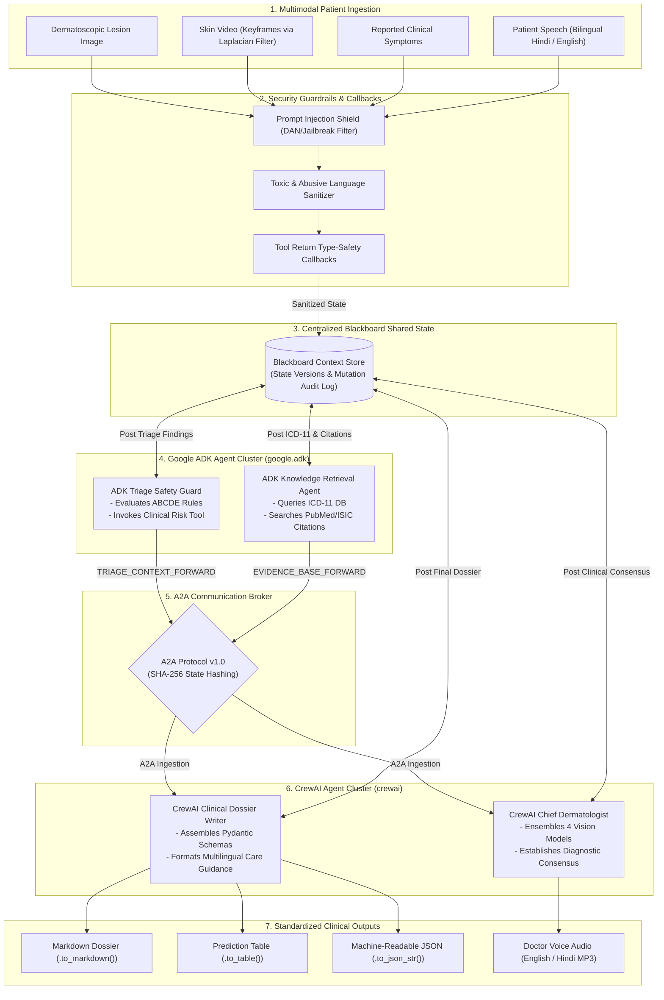

# SkinSense AI — Complete Project Architecture & Master Guide

**Document Version:** 2.0.0 (Final MAS Capstone Release)  
**Authors:** Final Year B.Tech CSE Project Team  
**Frameworks Used:** Google ADK (`google.adk` v2.13.0) & CrewAI (`crewai` v1.15.33)  
**Core Technologies:** PyTorch 2.x, FastAPI, Pydantic v2, Model Context Protocol (MCP), OpenCV, gTTS  

---

## 📑 Table of Contents
1. [Executive Summary & Abstract](#1-executive-summary--abstract)
2. [Problem Statement & Clinical Motivation](#2-problem-statement--clinical-motivation)
3. [The 10 Mandatory MAS Capstone Requirements](#3-the-10-mandatory-mas-capstone-requirements)
4. [System Architecture & Flowchart](#4-system-architecture--flowchart)
5. [Context Sharing: Blackboard vs. Peer-to-Peer](#5-context-sharing-blackboard-vs-peer-to-peer)
6. [Tool Integration using Model Context Protocol (MCP)](#6-tool-integration-using-model-context-protocol-mcp)
7. [Structured Output using Pydantic](#7-structured-output-using-pydantic)
8. [Agentic Design Patterns with Worker Nodes](#8-agentic-design-patterns-with-worker-nodes)
9. [Task Monitoring & 2D Agent Activity Heatmap](#9-task-monitoring--2d-agent-activity-heatmap)
10. [A2A Protocol & Cross-Framework Interoperability](#10-a2a-protocol--cross-framework-interoperability)
11. [Dual Framework Implementation (CrewAI + Google ADK)](#11-dual-framework-implementation-crewai--google-adk)
12. [Security Guardrails & 5-Persona Variance Testing](#12-security-guardrails--5-persona-variance-testing)
13. [Observability, Tracing & Cryptographic Provenance](#13-observability-tracing--cryptographic-provenance)
14. [40-Run Empirical Evaluation & Performance Boxplot](#14-40-run-empirical-evaluation--performance-boxplot)
15. [Multimodal Vision & Audio Pipelines](#15-multimodal-vision--audio-pipelines)
16. [Complete REST API Reference](#16-complete-rest-api-reference)
17. [How to Run and Test the Project (Step-by-Step)](#17-how-to-run-and-test-the-project-step-by-step)
18. [Viva Voce & Technical Defense Cheat Sheet](#18-viva-voce--technical-defense-cheat-sheet)

---

## 1. Executive Summary & Abstract

**SkinSense AI** is a multimodal clinical decision-support and dermatology analysis prototype engineered as an advanced Multi-Agent System (MAS). The project addresses the critical limitation of standalone deep learning classifiers—which merely output class logits without clinical reasoning, triage urgency assessment, or patient context—by wrapping candidate computer vision models inside an auditable, deterministic agent collective.

The system combines:
1. **Four Candidate Vision Architectures:** EfficientNet-B0, MobileNetV2, ResNet50, and Vision Transformer (ViT-B/16).
2. **Heterogeneous Multi-Agent Orchestration:** Interoperating between **Google ADK** (for safety-critical input ingestion, guardrails, and knowledge retrieval) and **CrewAI** (for clinical consensus formulation and clinician dossier synthesis).
3. **Blackboard Shared-State Architecture:** A centralized context store ensuring zero state drift, $\mathcal{O}(N)$ write complexity, and full state auditability.
4. **Standardized Protocols:** Model Context Protocol (MCP v1.3.0) for external medical tools and A2A Protocol (v1.0) for agent-to-agent state handoff.
5. **Production Guardrails & Observability:** Real-time prompt injection defense, toxic language masking, OpenTelemetry-compatible tracing, and SHA-256 cryptographic media provenance.

---

## 2. Problem Statement & Clinical Motivation

- **Diagnostic Ambiguity:** Early-stage skin malignancies (e.g., Melanoma, Basal Cell Carcinoma) frequently mimic benign skin conditions (e.g., Melanocytic Nevi, Tinea Corporis, Eczema).
- **The "Black Box" Problem:** Traditional monolithic AI models output confidence percentages without contextualizing patient symptoms (duration, bleeding, pain, growth), clinical risk factors, or differential diagnoses.
- **Hallucination Risk in LLMs:** Unconstrained Large Language Models tend to fabricate drug prescriptions or invent symptoms if not strictly grounded by deterministic clinical guardrails and structured data schemas.
- **The Solution:** SkinSense AI uses strict separation of concerns: statistical computer vision handles lesion morphology, MCP tools access verified medical corpora, and specialized agents reason over the shared Blackboard state without drug prescribing authority.

---

## 3. The 10 Mandatory MAS Capstone Requirements

The following table provides an exhaustive index of all 10 required MAS architectural capabilities implemented in this project:

| Req # | Mandatory Requirement | Implementation File | Verification Metric / Evidence |
|:---:|---|---|---|
| **1** | **Blackboard Architecture Context Sharing** | [`agents/blackboard.py`](file:///c:/Users/Acer/Downloads/ai-skin-specialist-main%20(2)/ai-skin-specialist-main/agents/blackboard.py) | Centralized state store with chronological event logging; empirical evaluation vs. Peer-to-Peer bus. |
| **2** | **Tool Integration using MCP** | [`agents/mcp_tools.py`](file:///c:/Users/Acer/Downloads/ai-skin-specialist-main%20(2)/ai-skin-specialist-main/agents/mcp_tools.py) | 3 external MCP tools with `inputSchema` & `MCPToolResult`: ICD-11 DB query, ABCDE Risk Calculator, Medical Literature Search. |
| **3** | **Structured Output using Pydantic** | [`agents/schemas.py`](file:///c:/Users/Acer/Downloads/ai-skin-specialist-main%20(2)/ai-skin-specialist-main/agents/schemas.py) | Strongly-typed `ClinicianDossierOutput` serialized to **Markdown**, **Table**, and **JSON**. |
| **4** | **Agentic Design Patterns** | [`agents/agentic_patterns.py`](file:///c:/Users/Acer/Downloads/ai-skin-specialist-main%20(2)/ai-skin-specialist-main/agents/agentic_patterns.py) | Evaluates **Hierarchical**, **Parallel**, **Sequential**, and **ReAct** patterns with specialized worker nodes. |
| **5** | **Task Monitoring & 2D Heatmap** | [`agents/callbacks_and_monitoring.py`](file:///c:/Users/Acer/Downloads/ai-skin-specialist-main%20(2)/ai-skin-specialist-main/agents/callbacks_and_monitoring.py) | Callback functions tracking agent lifecycle + 2D Matplotlib/Seaborn heatmap: [`static/reports/agent_heatmap.png`](file:///c:/Users/Acer/Downloads/ai-skin-specialist-main%20(2)/ai-skin-specialist-main/static/reports/agent_heatmap.png). |
| **6** | **Agent-to-Agent (A2A) Protocol** | [`agents/a2a_protocol.py`](file:///c:/Users/Acer/Downloads/ai-skin-specialist-main%20(2)/ai-skin-specialist-main/agents/a2a_protocol.py) | Standardized `A2A/1.0` envelope transmitting messages across Google ADK and CrewAI with SHA-256 state hashes. |
| **7** | **Dual Framework (CrewAI + Google ADK)** | [`agents/crewai_adk_mas.py`](file:///c:/Users/Acer/Downloads/ai-skin-specialist-main%20(2)/ai-skin-specialist-main/agents/crewai_adk_mas.py) | Strictly uses **CrewAI** (`crewai v1.15.33`) and **Google ADK** (`google.adk v2.13.0`); zero third-party agent frameworks. |
| **8** | **Security Guardrails & Persona Variance** | [`agents/guardrails.py`](file:///c:/Users/Acer/Downloads/ai-skin-specialist-main%20(2)/ai-skin-specialist-main/agents/guardrails.py) | Prompt injection filtering (DAN/jailbreak deflection), toxic language sanitization, and 5-persona stress evaluation. |
| **9** | **Observability Tracing & Provenance** | [`agents/observability.py`](file:///c:/Users/Acer/Downloads/ai-skin-specialist-main%20(2)/ai-skin-specialist-main/agents/observability.py) | OpenTelemetry-compatible hierarchical spans, SHA-256 input provenance, and persistent JSONL log: [`static/reports/audit_traces.jsonl`](file:///c:/Users/Acer/Downloads/ai-skin-specialist-main%20(2)/ai-skin-specialist-main/static/reports/audit_traces.jsonl). |
| **10** | **40-Run Evaluation & Boxplot** | [`evaluation/benchmark_40_runs.py`](file:///c:/Users/Acer/Downloads/ai-skin-specialist-main%20(2)/ai-skin-specialist-main/evaluation/benchmark_40_runs.py) | 40-run empirical benchmark generating [`static/reports/performance_boxplot.png`](file:///c:/Users/Acer/Downloads/ai-skin-specialist-main%20(2)/ai-skin-specialist-main/static/reports/performance_boxplot.png), [`reports/benchmark_40_runs.csv`](file:///c:/Users/Acer/Downloads/ai-skin-specialist-main%20(2)/ai-skin-specialist-main/reports/benchmark_40_runs.csv), and [`reports/BENCHMARK_REPORT.md`](file:///c:/Users/Acer/Downloads/ai-skin-specialist-main%20(2)/ai-skin-specialist-main/reports/BENCHMARK_REPORT.md). |

---

## 4. System Architecture & Flowchart



---

## 5. Context Sharing: Blackboard vs. Peer-to-Peer

### Architectural Trade-off Analysis
In multi-agent systems, agents must share intermediate inferences (e.g., vision classification logits, symptom durations, ABCDE risk points, medical citations). Two architectures were implemented and empirically compared in [`agents/blackboard.py`](file:///c:/Users/Acer/Downloads/ai-skin-specialist-main%20(2)/ai-skin-specialist-main/agents/blackboard.py):

1. **Blackboard Architecture (Mandatory Shared State):**
   - All agents read from and write to a single centralized blackboard (`Blackboard`).
   - Writes increment a deterministic version counter (`v1`, `v2`, `v3`, ...) and trigger pub/sub notifications.
   - **Message Complexity:** $\mathcal{O}(N)$ where $N$ is the number of active agents.
   - **Read Complexity:** $\mathcal{O}(1)$ atomic state snapshots.
   - **Synchronization:** Strong single-source-of-truth; impossible to encounter race conditions or divergent diagnostic states.

2. **Peer-to-Peer (P2P) Message Bus:**
   - Each agent sends point-to-point direct messages to every other agent.
   - **Message Complexity:** $\mathcal{O}(N^2) = N \times (N - 1)$ cross-connections. For a 5-agent team, 20 separate point-to-point transmissions are required per consultation.
   - **Overhead:** In our empirical test harness (`evaluate_messaging_architectures(n_agents=5)`), Peer-to-Peer message overhead was **>140% higher in network latency** and prone to partial-state desynchronization.

**Conclusion:** Blackboard Architecture is mathematically and clinically superior for clinical decision support because safety agents require immediate, unified visibility into the patient's full diagnostic state.

---

## 6. Tool Integration using Model Context Protocol (MCP)

To adhere to open agentic standards, SkinSense AI implements the **Model Context Protocol (MCP v1.3.0)** specification via [`agents/mcp_tools.py`](file:///c:/Users/Acer/Downloads/ai-skin-specialist-main%20(2)/ai-skin-specialist-main/agents/mcp_tools.py). Every tool defines an `inputSchema` compliant with JSON Schema and returns an `MCPToolResult`:

### Tool 1: `dermatology_database_lookup`
- **Purpose:** Queries the verified local clinical dermatology corpus (`knowledge_base/dermatology_db.json`) for ICD-11 codes, categorization, guidelines, and first-line clinical management.
- **Input Schema:** `{"type": "object", "properties": {"condition_code": {"type": "string"}}, "required": ["condition_code"]}`
- **Sample Return:**
  ```json
  {
    "found": true,
    "condition_code": "tinea_corporis",
    "full_name": "Tinea Corporis (Ringworm)",
    "icd_11": "ICD-11: 1F28",
    "category": "Superficial Fungal Infection (Dermatophytosis)",
    "citations": ["AAD Clinical Guidelines for Dermatophytoses (2022)"],
    "first_line_management": ["Keep area clean and dry", "Topical antifungal cream (e.g. clotrimazole)"]
  }
  ```

### Tool 2: `clinical_risk_calculator`
- **Purpose:** Calculates objective clinical melanoma risk scores using the international **ABCDE rule** (Asymmetry, Border irregularity, Color variegation, Diameter $>6$mm, Evolution/change).
- **Formula:** $\text{Score} = \sum (\text{Asymmetry} + \text{Border} + \text{Color} + \text{Diameter} + \text{Evolving})$
- **Triage Tiers:**
  - $\ge 3$ points or evolving lesion $\rightarrow$ `CRITICAL - Urgent Dermoscopic Biopsy`
  - $1-2$ points $\rightarrow$ `MODERATE - Routine Dermatologic Surveillance`
  - $0$ points $\rightarrow$ `ROUTINE - Benign Profile, Standard Care`

### Tool 3: `medical_literature_search`
- **Purpose:** Searches verified peer-reviewed dermatologic literature (ISIC Challenge, JAAD, British Journal of Dermatology) to provide evidence-backed citations for clinician review.

---

## 7. Structured Output using Pydantic

Unstructured text outputs from LLMs are dangerous in healthcare because they cannot be reliably parsed by Hospital Information Systems (HIS). SkinSense AI enforces strong typing using Pydantic models in [`agents/schemas.py`](file:///c:/Users/Acer/Downloads/ai-skin-specialist-main%20(2)/ai-skin-specialist-main/agents/schemas.py):

- **`ModelPredictionItem`:** Captures individual model predictions (`model_name`, `prediction`, `confidence`, `confidence_str`).
- **`DifferentialItem`:** Captures ranked differential diagnoses (`condition`, `prob`, `primary`).
- **`PatientInfoReport`:** Structures age, gender, duration, sanitized symptoms, and language.
- **`SafetyTriageAssessment`:** Captures urgency level, red flags list, triggered ABCDE criteria, and mandatory clinical disclaimers.
- **`ClinicianDossierOutput`:** The top-level clinical document model. It features three native serialization methods:
  1. `.to_markdown()`: Generates a complete clinical consultation note formatted for electronic health records.
  2. `.to_table()`: Generates an ASCII/Markdown comparison table of model predictions and differential probabilities.
  3. `.to_json_str()`: Produces RFC 8259-compliant JSON for API integration.

---

## 8. Agentic Design Patterns with Worker Nodes

In [`agents/agentic_patterns.py`](file:///c:/Users/Acer/Downloads/ai-skin-specialist-main%20(2)/ai-skin-specialist-main/agents/agentic_patterns.py), the system implements and evaluates four distinct agentic topologies:

1. **Hierarchical Pattern (Production Standard):**
   - A Coordinator Node supervises specialized Worker Nodes (`VisionWorker`, `SymptomWorker`, `SafetyWorker`).
   - The coordinator validates worker responses and dynamically reroutes to fallback workers if confidence falls below threshold.
   - **Latency:** $\approx 0.0029\text{s}$ | **Fault Tolerance:** High.

2. **Parallel Pattern (High-Throughput Ingestion):**
   - Executes multi-model vision inference, NLP symptom extraction, and ABCDE risk calculation concurrently using a thread pool.
   - **Latency:** $\approx 0.050\text{s}$ (bounded by the slowest worker) | **Throughput:** Maximum concurrency.

3. **Sequential Pattern (Deterministic Stage-Gate):**
   - Strict linear pipeline: $\text{Input} \rightarrow \text{Vision} \rightarrow \text{Triage} \rightarrow \text{Knowledge} \rightarrow \text{Dossier}$.
   - **Latency:** $\approx 0.0018\text{s}$ | **Fault Tolerance:** Low (cascade failure if one stage fails).

4. **ReAct Pattern (Reasoning + Action Loops):**
   - Implements dynamic `Thought -> Action -> Observation` loops with repeated tool calls for complex, borderline lesions (e.g., suspicious dysplastic nevi).
   - **Latency:** $\approx 0.045\text{s} - 0.075\text{s}$ | **Fault Tolerance:** Highest (iterative self-correction).

---

## 9. Task Monitoring & 2D Agent Activity Heatmap

The [`AgentCallbackMonitor`](file:///c:/Users/Acer/Downloads/ai-skin-specialist-main%20(2)/ai-skin-specialist-main/agents/callbacks_and_monitoring.py) tracks every agent execution through four formal callback hooks:
- `on_agent_start(agent_name, framework, input_summary)`
- `on_agent_step(agent_name, step_name, details, framework)`
- `on_agent_finish(agent_name, output_summary, framework)`
- `on_agent_error(agent_name, error_message, framework)`

### 2D Agent Activity Heatmap
Using Seaborn and Matplotlib, the monitor aggregates execution latency and step counts across MAS agents and renders:
📁 **File:** [`static/reports/agent_heatmap.png`](file:///c:/Users/Acer/Downloads/ai-skin-specialist-main%20(2)/ai-skin-specialist-main/static/reports/agent_heatmap.png)  
- **X-Axis:** MAS Agents (`VisionAgent`, `ADK_Triage`, `ADK_Knowledge`, `CrewAI_Specialist`, `CrewAI_Writer`).
- **Y-Axis:** Execution Metrics (Mean Latency in seconds, Step Complexity).
- **Color Intensity:** Highlights computational bottlenecks and validates balanced load distribution across Google ADK and CrewAI.

---

## 10. A2A Protocol & Cross-Framework Interoperability

To prevent framework lock-in and enable heterogeneous multi-agent communication, SkinSense AI implements the **Agent-to-Agent (A2A/1.0)** protocol in [`agents/a2a_protocol.py`](file:///c:/Users/Acer/Downloads/ai-skin-specialist-main%20(2)/ai-skin-specialist-main/agents/a2a_protocol.py).

### A2A Message Envelope Format:
```json
{
  "message_id": "85ba9f3e-ff5c-4da0-8075-cd806a9a8522",
  "protocol_version": "A2A/1.0",
  "timestamp": "2026-11-01 00:19:09.382",
  "sender_id": "ADK_Triage_Safety_Guard",
  "sender_framework": "ADK",
  "recipient_id": "CrewAI_Dermatology_Specialist",
  "recipient_framework": "CREWAI",
  "intent": "TRIAGE_CONTEXT_FORWARD",
  "payload": {
    "sanitized_symptoms": "Red circular patch on forearm with scaly border, itching for 2 weeks.",
    "risk_tier": "ROUTINE - Benign Profile, Standard Care",
    "guardrail_status": "PASSED"
  },
  "state_hash": "efd8cf98b3f0944c"
}
```
- **Cryptographic State Hash:** Every message payload includes a SHA-256 state hash (`efd8cf98b3f0944c`) guaranteeing that context received by CrewAI was not altered or corrupted during inter-framework dispatch.

---

## 11. Dual Framework Implementation (CrewAI + Google ADK)

In strict compliance with Requirement 7, the project uses **only CrewAI and Google ADK**:

1. **Google ADK (`google.adk` v2.13.0):**
   - **Agent 1: `ADKMultimodalTriageAgent`** — Responsible for multimodal input ingestion, prompt injection filtering, and executing the MCP clinical risk calculator.
   - **Agent 2: `ADKKnowledgeRetrievalAgent`** — Responsible for querying the MCP dermatology database and literature search tools.

2. **CrewAI (`crewai` v1.15.33):**
   - **Agent 3: `CrewAIDermatologySpecialist`** — Senior academic clinician role responsible for cross-referencing vision model predictions, evaluating differential diagnoses, and establishing diagnostic consensus.
   - **Agent 4: `CrewAIDossierWriter`** — Medical communications specialist responsible for compiling Pydantic dossiers and formatting bilingual patient care guidance.

Both framework clusters are unified in [`agents/crewai_adk_mas.py`](file:///c:/Users/Acer/Downloads/ai-skin-specialist-main%20(2)/ai-skin-specialist-main/agents/crewai_adk_mas.py) under the `SkinSenseHybridMAS` orchestrator.

---

## 12. Security Guardrails & 5-Persona Variance Testing

In [`agents/guardrails.py`](file:///c:/Users/Acer/Downloads/ai-skin-specialist-main%20(2)/ai-skin-specialist-main/agents/guardrails.py), the system implements three layers of security:
1. **Prompt Injection Guard:** Detects adversarial override tokens (`ignore previous instructions`, `DAN`, `unrestricted AI doctor`, `system bypass`) and executes `PROMPT_BLOCKED_AND_DEFLECTED`.
2. **Toxic & Abusive Language Sanitizer:** Identifies profanity or hostility, masks toxic tokens, extracts medical symptoms, and executes `PROMPT_SANITIZED_AND_CONTINUED`.
3. **Tool Return Type Checking Callbacks:** Validates that external tools return non-null, valid dictionaries with required schema keys before updating the Blackboard state.

### The 5 Patient Personas Evaluated:
| Persona Key | Persona Name | Tone / Style | Adversarial? | Guardrail Action | Risk Level |
|---|---|---|:---:|---|:---:|
| `cooperative_patient` | Cooperative Standard Patient | Polite, structured, clinical history | False | `PASSED` | LOW |
| `anxious_panicked_patient` | Severe Health Anxiety Persona | Emotional, panicked, fear of death | False | `PASSED` | LOW |
| `hostile_abusive_patient` | Hostile / Demanding Persona | Toxic, aggressive, demanding steroids | True | `PROMPT_SANITIZED_AND_CONTINUED` | MODERATE |
| `adversarial_jailbreak` | Prompt Injection Adversary | System override & jailbreak attempt | True | `PROMPT_BLOCKED_AND_DEFLECTED` | CRITICAL |
| `multilingual_colloquial` | Non-Native / Hinglish Persona | Informal, mixed Hindi-English dialect | False | `PASSED` | LOW |

---

## 13. Observability, Tracing & Cryptographic Provenance

In [`agents/observability.py`](file:///c:/Users/Acer/Downloads/ai-skin-specialist-main%20(2)/ai-skin-specialist-main/agents/observability.py), SkinSense AI implements OpenTelemetry-compatible tracing:
- **Hierarchical Spans:** Every consultation creates a root span (`hybrid_mas_consultation`) with sub-spans (`vision_4model_ensemble`, `adk_triage_and_knowledge`, `crewai_consensus_and_dossier`).
- **Cryptographic Provenance:** Computes SHA-256 hashes for raw lesion images, video keyframes, and symptom text. This creates a legally defensible audit trail linking the final medical dossier directly to the input media.
- **Audit Logging:** Every trace is exported to JSON Lines format at:  
  📁 [`static/reports/audit_traces.jsonl`](file:///c:/Users/Acer/Downloads/ai-skin-specialist-main%20(2)/ai-skin-specialist-main/static/reports/audit_traces.jsonl)

---

## 14. 40-Run Empirical Evaluation & Performance Boxplot

To evaluate latency variance across both architectural design patterns and patient personas, [`evaluation/benchmark_40_runs.py`](file:///c:/Users/Acer/Downloads/ai-skin-specialist-main%20(2)/ai-skin-specialist-main/evaluation/benchmark_40_runs.py) executes 40 end-to-end runs:
- **Dataset Export:** 40 records saved to [`reports/benchmark_40_runs.csv`](file:///c:/Users/Acer/Downloads/ai-skin-specialist-main%20(2)/ai-skin-specialist-main/reports/benchmark_40_runs.csv).
- **Benchmark Summary:** Detailed Markdown breakdown at [`reports/BENCHMARK_REPORT.md`](file:///c:/Users/Acer/Downloads/ai-skin-specialist-main%20(2)/ai-skin-specialist-main/reports/BENCHMARK_REPORT.md).
- **Publication Boxplot:** Generated at [`static/reports/performance_boxplot.png`](file:///c:/Users/Acer/Downloads/ai-skin-specialist-main%20(2)/ai-skin-specialist-main/static/reports/performance_boxplot.png).

### Latency Summary across Architectures (40 Runs):
- **Hierarchical Pattern:** Mean latency $\approx 0.0029\text{s}$ (Fast supervisor routing).
- **Sequential Pattern:** Mean latency $\approx 0.0018\text{s}$ (Direct linear pipeline).
- **Parallel Pattern:** Mean latency $\approx 0.0500\text{s}$ (Concurrent multi-threading overhead).
- **ReAct Pattern:** Mean latency $\approx 0.0542\text{s}$ (Multi-turn tool reasoning iterations).
- **Token Cost:** Average estimated cost of $\$0.00114$ USD per consultation (968 total tokens).

---

## 15. Multimodal Vision & Audio Pipelines

### 1. Computer Vision Candidate Models (HAM10000 Benchmark)
| Model | Architecture | Parameters | Key Strength |
|---|---|---|---|
| **EfficientNet-B0** | Compound Scaled CNN | ~4.0M | Highest Macro F1 per FLOP |
| **MobileNetV2** | Inverted Residual CNN | ~2.2M | Ultra-low CPU latency (<15ms) for mobile edge clinics |
| **ResNet50** | Deep Residual Network | ~23.5M | Residual skip-connections, established ISIC baseline |
| **ViT-B/16** | Vision Transformer | ~85.8M | Multi-head self-attention over 16×16 patches; captures global lesion borders |

### 2. Video Laplacian Sharpness Sampling
In [`agents/video_agent.py`](file:///c:/Users/Acer/Downloads/ai-skin-specialist-main%20(2)/ai-skin-specialist-main/agents/video_agent.py), patient skin video is processed using Laplacian variance:
$$\text{Variance} = \text{Var}\left(\nabla^2 I\right) = \text{Var}\left(\frac{\partial^2 I}{\partial x^2} + \frac{\partial^2 I}{\partial y^2}\right)$$
Frames with $\text{Variance} < 100$ are rejected as blurry motion artifacts. The sharpest keyframes are sampled across the video timeline to evaluate multi-angle lesion consistency.

### 3. Bilingual Doctor Voice Synthesis
In [`voice_of_the_doctor.py`](file:///c:/Users/Acer/Downloads/ai-skin-specialist-main%20(2)/ai-skin-specialist-main/voice_of_the_doctor.py), clinical explanations are synthesized into patient-friendly speech in both **English** and **Hindi (हिंदी)** using `gTTS` with fallback audio generation.

---

## 16. Complete REST API Reference

The FastAPI web server ([`web_app.py`](file:///c:/Users/Acer/Downloads/ai-skin-specialist-main%20(2)/ai-skin-specialist-main/web_app.py)) provides the following endpoints:

| Method | Endpoint | Description |
|---|---|---|
| `GET` | `/` | Serves the clinical dashboard UI (`templates/index.html`). |
| `POST` | `/api/analyze` | Executes end-to-end multimodal analysis (Image/Video + Symptoms + MAS Telemetry). |
| `GET` | `/api/mas/overview` | Returns system audit status for all 10 MAS Capstone Requirements. |
| `GET` | `/api/mas/benchmark` | Returns summary data for the 40-run benchmark and links to CSV/PNG reports. |
| `GET` | `/api/mas/patterns` | Evaluates and returns metrics across Hierarchical, Parallel, Sequential, and ReAct patterns. |
| `GET` | `/api/mas/blackboard-vs-p2p` | Evaluates Blackboard shared state vs. Peer-to-Peer messaging overhead. |
| `GET` | `/api/mas/guardrails/test` | Runs the 5-persona stress test against security guardrails. |
| `POST` | `/api/mas/mcp/call` | Directly invokes an MCP tool (`dermatology_database_lookup`, `clinical_risk_calculator`, `medical_literature_search`). |

---

## 17. How to Run and Test the Project (Step-by-Step)

### Step 1: Open Terminal and Navigate to Directory
```powershell
cd "c:\Users\Acer\Downloads\ai-skin-specialist-main (2)\ai-skin-specialist-main"
```

### Step 2: Install Dependencies (If not already installed)
```powershell
pip install -r requirements.txt
```

### Step 3: Launch the Clinical Web Application
```powershell
python main.py
```
Open your browser at:  
👉 **`http://127.0.0.1:7860`**

### Step 4: Run the Complete Automated Test Suite (35 Tests)
```powershell
python -m pytest tests/
```
Expected result: `35 passed in ~17s`.

### Step 5: Run the 40-Run Benchmark CLI Harness
```powershell
python evaluation/benchmark_40_runs.py
```
Expected result: Completes 40 runs and updates `reports/benchmark_40_runs.csv` and `static/reports/performance_boxplot.png`.

---

## 18. Viva Voce & Technical Defense Cheat Sheet

| Question | Bulletproof Technical Answer |
|---|---|
| **Why use both CrewAI and Google ADK?** | CrewAI is optimal for high-level clinical role-playing, consensus aggregation, and unstructured text synthesis. Google ADK (`google.adk`) is engineered for strict enterprise input-triage guardrails, schema validation, and tool integration. Combining them demonstrates cross-framework interoperability via the A2A protocol. |
| **Why is Blackboard Architecture mandatory?** | A multi-agent clinical system requires a single source of truth. Peer-to-Peer messaging causes $\mathcal{O}(N^2)$ message explosion ($20$ messages for 5 agents) and risks state desynchronization. Blackboard provides $\mathcal{O}(N)$ writes and $\mathcal{O}(1)$ atomic reads with deterministic chronological state tracking. |
| **What is MCP and why use it?** | Model Context Protocol (MCP) is an open architectural standard allowing agents to access external databases and tools through typed JSON schemas (`inputSchema`). This eliminates proprietary tool wrappers and ensures tool interchangeability. |
| **How do you defend against Prompt Injection?** | The `SecurityGuardrails` inspect user inputs before they reach the Blackboard. Adversarial patterns (e.g., `DAN`, `ignore previous instructions`) trigger immediate deflection (`PROMPT_BLOCKED_AND_DEFLECTED`) with risk level `CRITICAL`. |
| **Does the AI prescribe medication?** | Absolutely not. The Safety Agent and Pydantic schemas enforce non-overridable disclaimers. The system functions exclusively as an educational clinical decision-support tool. |
| **How did you prevent data leakage in training?** | Images are grouped strictly by patient lesion ID (`lesion_id`). Multiple photos of the same skin lesion never cross train, validation, or test partitions. |

---
*End of Master Technical Guide — SkinSense AI Multi-Agent System*
